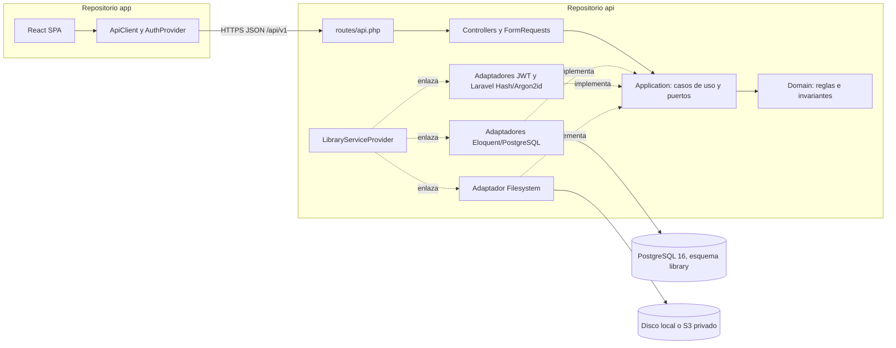

# Arquitectura — Manager Library (PHP + Laravel + React)

La variante del reto conserva las reglas de dominio y el contrato de las referencias Python/.NET, pero se despliega como dos aplicaciones: una API JSON en Laravel y una SPA React. El backend aplica arquitectura hexagonal dentro de Laravel; Eloquent y el framework permanecen en adaptadores.

## 1. Componentes y dependencias



Las dependencias de código apuntan hacia el dominio. El provider registra bindings, no contiene lógica de negocio. React nunca accede directamente a PostgreSQL ni al almacenamiento.

## 2. Estructura de los repositorios

### Backend `test-manager-library-3145555-api`

```text
app/
├── Domain/
│   ├── Book/             # Book, Isbn, Quantity, reglas de inventario
│   ├── Loan/             # Loan, LoanItem y estado calculado
│   ├── Member/           # Member y reglas de document_number
│   └── User/             # User y roles
├── Application/
│   ├── Ports/            # Interfaces de repositorios, Clock, TokenIssuer, PasswordHasher, CoverStorage
│   ├── DTOs/             # Entradas y salidas independientes de HTTP/Eloquent
│   └── Services/         # Un caso de uso por operación
├── Adapters/
│   ├── Inbound/Http/     # Controllers, FormRequests, Resources, middleware y error mapping
│   └── Outbound/
│       ├── Persistence/Eloquent/ # Models y repositorios PostgreSQL
│       ├── Security/     # Laravel Hash Argon2id y JWT HS256
│       └── Storage/      # Laravel Filesystem
└── Providers/
    └── LibraryServiceProvider.php
routes/api.php
bootstrap/providers.php
database/migrations/
 tests/Unit/Domain/
 tests/Unit/Application/
 tests/Feature/Http/
 tests/Architecture/
```

Los modelos Eloquent especifican `library.<tabla>`, configuran `DB_SCHEMA=public` como `search_path` y declaran `$timestamps = false`. Se omiten las migraciones starter que crean `users`, `sessions`, `cache` o `jobs`; la única tabla técnica adicional es `public.migrations`, fuera del esquema de negocio. `LibraryUserRecord` mapea el usuario de dominio a `library."user"`, sin usar `App\Models\User` ni la tabla `users` convencional.

`LibraryServiceProvider` se registra en `bootstrap/providers.php` y es el único lugar donde se enlazan los puertos a sus adaptadores. Las rutas de Laravel se agrupan con prefijo `v1`, para exponer `/api/v1` sin duplicar el prefijo `/api` que aplica Laravel.

### Frontend `test-manager-library-3145555-app`

```text
src/
├── api/                 # cliente HTTP, tipos de request/response del contrato
├── auth/                # AuthProvider, login, protección por rol
├── features/
│   ├── books/           # catálogo, edición y portadas
│   ├── members/         # búsqueda y alta
│   ├── loans/           # préstamo, devolución, listado y vencidos
│   └── reports/         # reporte de más prestados
├── components/          # controles reutilizables y estados de carga/error
└── routes/              # rutas de la SPA
```

El cliente configura `VITE_API_BASE_URL`; el token Bearer se adjunta desde un único `ApiClient`. El frontend presenta errores en español y conserva los nombres JSON `snake_case` al comunicarse con la API.

## 3. Pantallas y permisos React

Las rutas de la SPA son vistas del contrato, no endpoints nuevos. `AuthProvider` carga la identidad desde el token; una ruta protegida oculta la vista si no hay sesión y los controles de rol solo mejoran la experiencia: Laravel siempre vuelve a autorizar la petición.

| Ruta de la SPA | Rol | Vista y acciones |
|---|---|---|
| `/login` | Público | Ingresar credenciales y mostrar error genérico de autenticación |
| `/books` | `admin`, `librarian` | Buscar y paginar catálogo; el admin crea/edita/da de baja y gestiona portada |
| `/members` | `admin`, `librarian` | Buscar, consultar y crear socios; no hay acción de borrado |
| `/loans` | `admin`, `librarian` | Filtrar y paginar préstamos; iniciar préstamo y abrir detalle |
| `/loans/:id` | `admin`, `librarian` | Ver líneas, estado calculado y devolver cada línea una sola vez |
| `/loans/overdue` | `admin`, `librarian` | Consultar vencidos con orden/paginación del contrato |
| `/reports/most-borrowed` | `admin` | Elegir rango de fechas y ver reporte agregado |

El socio no tiene cuenta ni ruta de login. La interfaz no inventa multas, reservas ni renovaciones.

## 4. Componentes de dominio y adaptadores

| Área | Dominio/aplicación | Adaptador Laravel |
|---|---|---|
| Libros | `Book`, `Isbn`, `Quantity`; `BookRepository` | Eloquent repository con filtro de activos, control `inventory_version` y query de búsqueda |
| Socios | `Member`; `MemberRepository` | Repositorio Eloquent, valor opaco `document_number` |
| Préstamos | `Loan`, `LoanItem`; `LoanRepository` | Transacción PostgreSQL que persiste cabecera, líneas y decrementos |
| Reloj | `Clock` | `SystemClock` y reloj fijo de PHPUnit; reloj demo solo en T-26 |
| Reportes | `ReportReader` | Consulta agregada en PostgreSQL sobre las columnas congeladas |
| Portadas | `CoverStorage` | Laravel Filesystem; `cover_key` opaca en PostgreSQL |
| Autenticación | `PasswordHasher`, `TokenIssuer` | Laravel `Hash` con Argon2id y emisión/verificación JWT HS256 |
| HTTP | DTOs y errores de aplicación | Controllers, `FormRequest`, middleware Bearer/roles y renderer del error común |

Los `FormRequest` validan forma, rango y tipos de entrada; los casos de uso y el dominio son autoridad para reglas de negocio. Las restricciones del motor siguen siendo la última barrera ante concurrencia y escrituras externas.

## 5. Flujo transaccional de préstamo

```mermaid
sequenceDiagram
    participant R as React SPA
    participant H as Laravel HTTP
    participant S as LendBooksService
    participant M as MemberRepository
    participant B as BookRepository
    participant L as LoanRepository
    participant PG as PostgreSQL
    R->>H: POST /api/v1/loans + Bearer JWT
    H->>H: autenticar token y autorizar admin/librarian
    H->>S: DTO(member_id, book_ids, authenticated_user_id)
    S->>M: cargar socio, líneas abiertas y vencidos
    S->>S: comprobar límite y vencidos
    S->>B: cargar libros activos por lote
    S->>S: construir Loan y snapshots congelados
    S->>PG: BEGIN
    S->>B: UPDATE stock WHERE id + inventory_version esperado
    B->>PG: decremento condicional y versión + 1
    PG-->>B: fila actualizada o conflicto
    S->>S: si conflicto: releer y reintentar una vez
    S->>L: persistir préstamo y líneas
    L->>PG: COMMIT; todo junto o rollback
    S-->>H: DTO de préstamo o error de dominio
    H-->>R: 201 o cuerpo de error común
```

Si el último ejemplar ya no está disponible, el caso de uso responde `409 BOOK_NOT_AVAILABLE`. Si la versión vuelve a cambiar tras el único reintento y quedan existencias, responde `409 BOOK_CONCURRENTLY_MODIFIED`. La operación no deja préstamo, líneas ni decrementos parciales.

## 6. HTTP, errores y autorización

- `routes/api.php` define `/health`, login y rutas `/v1`; las rutas de negocio requieren autenticación Bearer.
- Middleware valida firma HS256, `exp`, `sub` y rol. Las políticas de rol se aplican antes de ejecutar el caso de uso.
- `FormRequest` no emite el formato de error Laravel directamente: el manejador global lo traduce al JSON único definido en [`api-contract.md`](api-contract.md).
- Los controllers transforman DTOs a Resources HTTP; no exponen modelos Eloquent, `password_hash`, rutas del servidor ni stack traces.
- La operación de portada devuelve bytes y `Content-Type` permitido; `cover_key` no es una ruta pública.

## 7. Integración React y Laravel

React es una SPA separada, servida desde el repo `app`; Laravel solo sirve JSON y bytes de portadas. CORS acepta el origen configurado, no `*`. En despliegues no locales ambas aplicaciones usan HTTPS. No se añade SSR, Blade para la aplicación operativa, una segunda API ni autenticación por cookie/sesión.

## 8. Arranque e infraestructura

El servicio PostgreSQL vacío puede levantarse por separado para ejecutar migraciones y pruebas de integración antes de terminar ambos aplicativos. El Compose de entrega integra PostgreSQL, API y React en una red privada: espera la salud del motor, ejecuta las migraciones de Laravel, aprovisiona el admin de forma idempotente y luego expone los servicios. `infra` no contiene DDL; no se inicia la API contra un esquema sin migrar.

## 9. Límites deliberados

No hay colas, microservicios, caché, multitenencia, multas, reservas ni renovaciones. Se implementan únicamente cuando una futura especificación los requiera.
