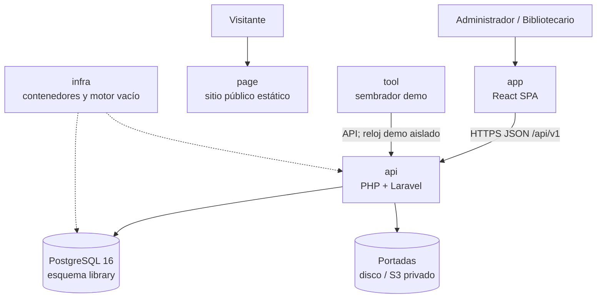

# Arquitectura en una página — Manager Library (PHP + Laravel + React)

Vista rápida del stack que se implementa en el reto. Los detalles de capas y pruebas están en [`architecture.md`](architecture.md); los contratos comunes, en [`spec.md`](spec.md), [`data-model.md`](data-model.md) y [`api-contract.md`](api-contract.md).

## Sistema

## Repositorios y responsabilidad

| Repo | Responsabilidad | Evidencia principal |
|---|---|---|
| `docs/spec-php` | Especificación ejecutable del stack del reto | Trazabilidad de historias, modelo, API y tareas |
| `api` | Casos de uso, API Laravel y persistencia | Pruebas PHP unitarias, integración, contrato y concurrencia |
| `app` | Pantallas operativas React | Flujo login → préstamo → devolución → vencidos → reporte |
| `page` | Presentación pública estática | Revisión en móvil y escritorio, sin depender de la API |
| `infra` | Compose, red, volúmenes y PostgreSQL vacío | Arranque repetible con un comando |
| `tool` | Datos de demostración usando la API | 40 libros, 10 socios, 15 préstamos y 3 vencidos reproducibles |

## Reglas que no cambian con la tecnología

1. El préstamo es inmutable; solo se registra la devolución por línea.
2. Descuento de inventario, cabecera y líneas se confirman en una sola transacción.
3. Estado y retraso se calculan; no son columnas persistidas.
4. Título, ISBN y categoría de la línea se congelan al prestar.
5. PostgreSQL impone las invariantes declaradas y bloquea escrituras inconsistentes.
